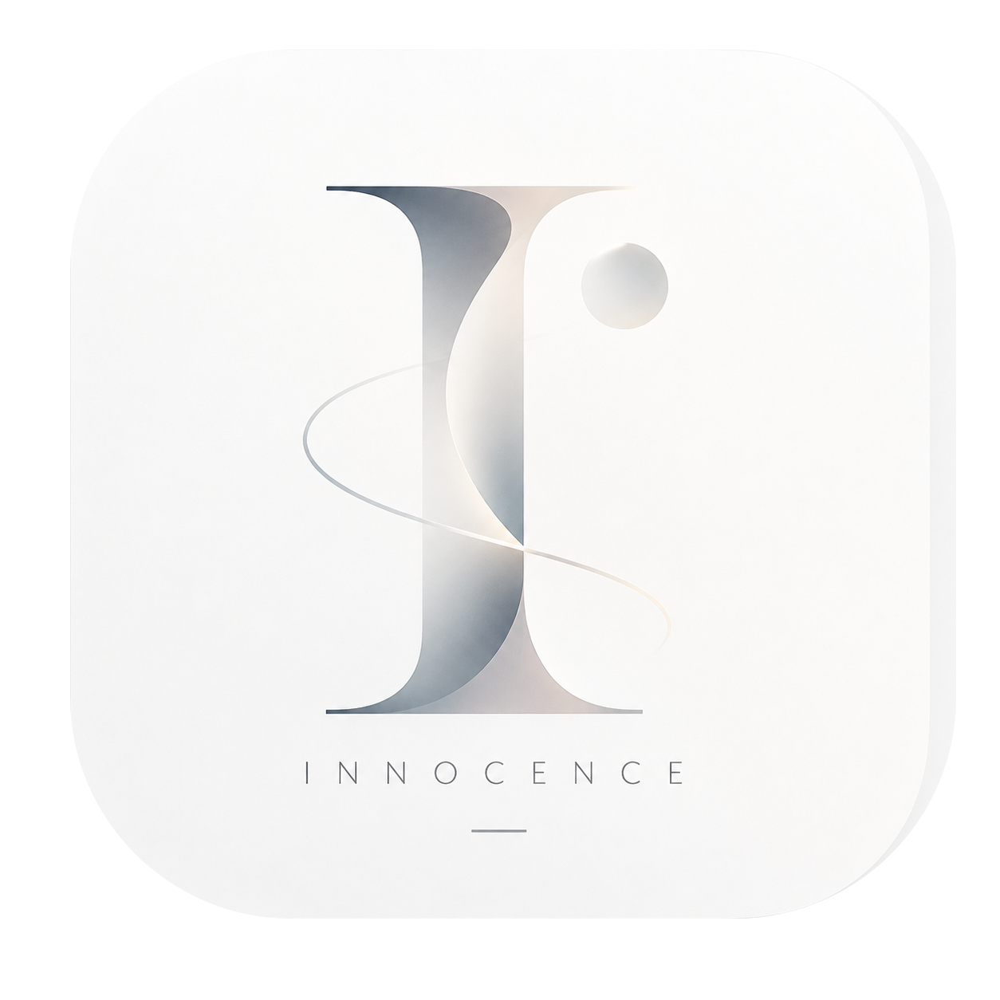

<p align="center">
  
</p>

<h1 align="center">Innocence</h1>

<p align="center">面向学习、自律、陪伴和团队互助的双端应用</p>

<p align="center">
  <a href="README.md">简体中文</a> · <a href="README_EN.md">English</a>
</p>

<p align="center">
  <a href="LICENSE"></a>
  
  =3.4">
  
  
  
</p>

Innocence 当前以 Flutter + Spring Boot 为主线，覆盖 Windows 桌面端与移动端。

## 下载

| 平台 | 下载 | 范围 |
|---|---|---|
| Windows x64 · v1.3.0 | [安装器](https://github.com/2877905731/Innocence/releases/download/v1.3.0/Innocence-v1.3.0-windows-x64-setup.exe) · [便携 ZIP](https://github.com/2877905731/Innocence/releases/download/v1.3.0/Innocence-v1.3.0-windows-x64-portable.zip) | 联网版，安装器尚未代码签名 |
| Android 7.0+ · v1.3.0 | [联网 APK](https://github.com/2877905731/Innocence/releases/download/v1.3.0/Innocence-v1.3.0-android-online.apk) | 原发行证书；可覆盖正式旧版保留资料 |
| 鸿蒙平板联网版 · v1.3.0 | [ARM64 Release HAP](https://github.com/2877905731/Innocence/releases/tag/v1.3.0-harmonyos.1) | 未签名 AOT，需自己的设备 Profile／签名及 DevEco/HDC |

[v1.3.0 发布说明](https://github.com/2877905731/Innocence/releases/tag/v1.3.0) · [SHA256 校验清单](https://github.com/2877905731/Innocence/releases/download/v1.3.0/SHA256SUMS.txt) · [历史离线版](https://github.com/2877905731/Innocence/releases/tag/v1.2.6) · [更新日志](CHANGELOG.md)

v1.3.0 三端连接生产HTTPS服务，同账号允许手机、电脑、平板各一个名额同时在线。Android可用原发行签名覆盖正式旧版保留资料。登录后先预览目标账号并确认本机资料导入；服务器未迁移本机账号。鸿蒙HUKS密钥仓储已接入，公开HAP仍未签名，动态和后台阶段提醒仍有权益及预排窗口限制，详见发行说明。

首次进入可登录服务器邮箱账号或选择本机模式。本机资料保存在设备，卸载／清除数据会丢失；此前开发Debug APK与正式版签名不同，不能直接覆盖。真实HTTPS登录/导入/跨用户拒绝和三类会话已核对，实体手机/OEM/Vulkan及长期容量矩阵继续待验。

## 当前状态

- Windows 端采用 Large / Medium / Small 自适应画布与 Focus Orb。
- Windows 应用、窗口和系统托盘，以及 Android 应用已使用正式 Innocence Logo。
- Windows 保留简约白色、侘寂、Mid-Century Modern 和液态玻璃四套主题；Android 已接入简约白色与液态玻璃视觉及 Material 3 交互基础。
- Android 提供原证书签名的联网版及历史离线版，短计划按24小时圆盘选取当天时间段。
- 已具备认证、资料、设置、备忘录、统计、通知、好友和团队等主要交互骨架。
- 后端业务数据按当前登录用户隔离。
- Windows 聊天助手支持填地址与 Key 获取模型、选择连接及经确认的本机工具操作；真实供应商与完整设备矩阵继续验收。
- 鸿蒙平板提供[ARM64 Release 联网包](https://github.com/2877905731/Innocence/releases/tag/v1.3.0-harmonyos.1)，复用PC全屏页面，启用INTERNET权限及独立tablet槽位/HUKS加密仓储。公开包需接收者自行签名；个人签名包不公开。网页分发与HAP点文件直装的区别见[安装说明](client/flutter_app/harmonyos/INSTALL.zh-CN.md)。完整实体业务/恢复/性能矩阵继续待验。

## 仓库结构

```text
client/flutter_app/       Flutter 客户端
server/innocence-server/  Spring Boot 服务端
docs/                     产品、契约与排查文档
infra/docker/             MySQL / Redis 本地开发基础设施
progress/                 项目进度与检查点
```

## 技术栈

- 客户端：Flutter、Dart、Material 3、shared_preferences
- 服务端：Java21、Spring Boot3.5.16、MyBatis、MySQL8、Redis
- 平台：Windows、Android

## 本地开发

### 启动依赖

在 `infra/docker` 下启动 `docker-compose.dev.yml`，默认使用 MySQL `3306` 和 Redis `6379`。

### 启动服务端

```bash
cd server/innocence-server
mvn spring-boot:run
```

需要 JDK 21 和 Maven 3.9+。邮件密码通过 `INNOCENCE_MAIL_PASSWORD` 环境变量注入。

### 启动客户端

```bash
cd client/flutter_app
flutter pub get
flutter run -d windows
```

Windows 发布版本：

```bash
flutter build windows --release
```

产物位于 `build/windows/x64/runner/Release/`。

## 文档

- [文档索引](docs/README.md)
- [项目计划](docs/planning/Innocence-项目计划书.md)
- [Windows 自适应桌面体验](docs/planning/Innocence-Windows自适应桌面体验.md)
- [前端修改未生效排查](docs/troubleshooting/Innocence-前端修改未生效排查.md)

## 项目地址

[github.com/2877905731/Innocence](https://github.com/2877905731/Innocence)
