<p align="center">
  
</p>

<h1 align="center">Innocence</h1>

<p align="center">A cross-platform companion for learning, self-discipline, focus, and teamwork</p>

<p align="center">
  <a href="README.md">简体中文</a> · <a href="README_EN.md">English</a>
</p>

<p align="center">
  <a href="LICENSE"></a>
  
  =3.4">
  
  
  
</p>

Innocence is built with Flutter and Spring Boot and currently targets Windows desktop and mobile devices.

## Downloads

| Platform | Download | Scope |
|---|---|---|
| Windows x64 · v1.3.3 | [Installer](https://github.com/2877905731/Innocence/releases/download/v1.3.3/Innocence-v1.3.3-windows-x64-setup.exe) · [Portable ZIP](https://github.com/2877905731/Innocence/releases/download/v1.3.3/Innocence-v1.3.3-windows-x64-portable.zip) | Online desktop edition; installer has no Authenticode signature |
| Android 7.0+ · v1.3.3 | [Online APK](https://github.com/2877905731/Innocence/releases/download/v1.3.3/Innocence-v1.3.3-android-online.apk) | Custom timers, credited manual pomodoro stages, multiple chats, and new wordmarks; original release signature |
| HarmonyOS tablet online edition · v1.3.3 | [ARM64 Release HAP](https://github.com/2877905731/Innocence/releases/tag/v1.3.3-harmonyos.1) | Unsigned AOT; requires a matching device profile, signing, and DevEco/HDC |

[Android v1.3.3 release notes](https://github.com/2877905731/Innocence/releases/tag/v1.3.3) · [Android SHA256](https://github.com/2877905731/Innocence/releases/download/v1.3.3/SHA256SUMS.txt) · [Windows v1.3.3](https://github.com/2877905731/Innocence/releases/tag/v1.3.3) · [Changelog](CHANGELOG.md)

v1.3.3 adds custom focus durations, manually started pomodoro stages with study credit, annual-task assistant fixes, multiple deletable chats, and original Innocence theme wordmarks. The required study-credit and request-tracing backend is deployed. Independent device sessions and confirmed local-data import remain in place; an in-app update service is not included.

Sign in with a server account or choose local mode. Local data is uploaded only after previewing and confirming the target account. Keep the installed app and its data when updating. Physical-device/OEM/Vulkan checks and long-running performance remain in progress.

## Current Status

- Adaptive Large, Medium, and Small Windows canvases with a Focus Orb.
- The official Innocence logo is used by Windows and Android.
- Windows retains Minimal White, Wabi-Sabi, Mid-Century Modern, and Liquid Glass themes. Android includes Minimal White and Liquid Glass visuals with Material 3 interaction components.
- A signed Android offline edition is available, including daily time ranges selected on a 24-hour clock.
- Core interaction foundations for authentication, profiles, settings, memos, statistics, notifications, friends, and teams.
- Backend business data is isolated by the currently authenticated user.
- Windows chat supports model discovery from an address and key, plus confirmed local actions. Live-provider and complete device checks remain pending.
- HarmonyOS provides an [unsigned ARM64 online Release](https://github.com/2877905731/Innocence/releases/tag/v1.3.3-harmonyos.1). The owner’s tablet has received the matching private signed 1.3.3 update; public recipients still need their own signing/profile. Full device, background-rights, and live-model checks remain pending.

## Repository Layout

```text
client/flutter_app/       Flutter client
server/innocence-server/  Spring Boot backend
docs/                     Product, contract, and troubleshooting documentation
infra/docker/             Local MySQL and Redis infrastructure
progress/                 Project progress and checkpoints
```

## Technology Stack

- Client: Flutter, Dart, Material 3, and shared_preferences
- Backend: Java 21, Spring Boot 3.3.2, MyBatis, MySQL 8, and Redis
- Platforms: Windows and Android

## Local Development

### Start the dependencies

From `infra/docker`, start `docker-compose.dev.yml`. The default ports are MySQL `3306` and Redis `6379`.

### Start the backend

```bash
cd server/innocence-server
mvn spring-boot:run
```

Java 21 and Maven 3.9 or later are required. The mail password is supplied through the `INNOCENCE_MAIL_PASSWORD` environment variable.

### Start the client

```bash
cd client/flutter_app
flutter pub get
flutter run -d windows
```

Build the Windows release:

```bash
flutter build windows --release
```

The output is written to `build/windows/x64/runner/Release/`.

## Documentation

- [Documentation index](docs/README.md)
- [Project plan](docs/planning/Innocence-项目计划书.md)
- [Windows adaptive desktop experience](docs/planning/Innocence-Windows自适应桌面体验.md)
- [Troubleshooting stale frontend changes](docs/troubleshooting/Innocence-前端修改未生效排查.md)

## License

Innocence is distributed under the [GNU Affero General Public License v3.0](LICENSE).

## Project

[github.com/2877905731/Innocence](https://github.com/2877905731/Innocence)
